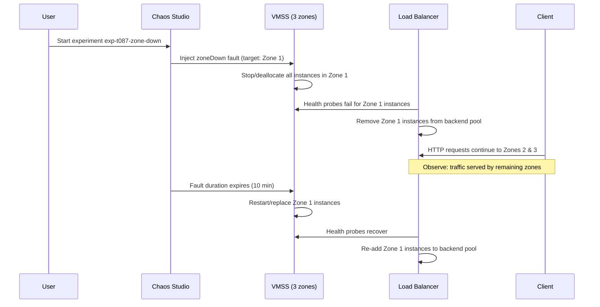

# Chaos Studio Experiment Configuration — NOT EXECUTED

> **Status:** Configured/Planned only. **Never executed.**
> **Blocker:** Subscription-level "Allowed resource deployment regions" policy prevented Chaos Studio from deploying its internal agent/resources.

---

## Experiment Overview

| Property | Value |
|----------|-------|
| **Experiment Name** | `exp-t087-zone-down` |
| **Chaos Studio Workspace** | `chaos-t087` |
| **Target Resource** | `vmss-t087-chaos-resilience` (VM Scale Set) |
| **Target Resource ID** | `/subscriptions/<subscription-id>/resourceGroups/rg-t087-chaos-resilience/providers/Microsoft.Compute/virtualMachineScaleSets/vmss-t087-chaos-resilience` |
| **Fault Type** | `Microsoft.Compute/virtualMachineScaleSets/zoneDown` |
| **Intended Duration** | 10 minutes |
| **Intended Scope** | All instances across Zones 1, 2, 3 (simulated full zone outage) |
| **Status** | **NOT EXECUTED** — Saved configuration only |

---

## Experiment Design (Planned)

### Fault Injection: Zone Down

The `zoneDown` fault simulates an **entire Availability Zone becoming unavailable**. When injected against a VMSS:

- All VMSS instances in the targeted zone are stopped/deallocated
- The VMSS orchestrator attempts to maintain capacity by scaling out in remaining zones (if configured)
- Load Balancer health probes detect unhealthy instances and stop routing traffic

### Intended Experiment Flow



### Expected Observations (Had It Run)

| Metric | Expected Behavior |
|--------|-------------------|
| **Detection Time** | ~10–15 seconds (health probe: 5s interval × 2 threshold) |
| **Traffic Impact** | Brief 5xx/connection errors during detection window |
| **Recovery** | VMSS replaces instances in affected zone (~2–3 min) |
| **Availability** | Zone-redundant LB + multi-zone VMSS should maintain service |

---

## Why It Was Not Executed

### Policy Restriction

The subscription has an **Azure Policy** assigned at the management group or subscription level:

- **Policy Name/Type**: "Allowed resource deployment regions" (built-in or custom)
- **Effect**: `Deny`
- **Allowed Regions**: List does not include the region required by Chaos Studio for its internal agent deployment

### Chaos Studio Agent Deployment

When a Chaos Studio experiment starts, the service deploys **internal agent resources** (Microsoft.Chaos/agents) in the target region to orchestrate fault injection. The policy blocks this deployment.

### Error Message (Typical)

```
The resource operation completed with terminal provisioning state 'Failed'.
Details: Resource 'chaos-agent-xxx' was disallowed by policy.
Policy definition: 'Allowed resource deployment regions'
```

---

## Remediation Options

| Option | Description | Effort |
|--------|-------------|--------|
| **Policy Exception** | Request policy owner to add Chaos Studio's required region to allowed list | Low (org process) |
| **Policy Override** | Use policy exemption (if permitted by governance) | Medium |
| **Alternative Region** | Deploy workload in a region already allowed by policy | High (re-deploy) |
| **Manual Testing** | Continue with controlled deallocate/start tests (current approach) | None |

---

## Current Testing Approach

Since Chaos Studio zone-down experiment cannot run, the project validated resilience using **controlled manual tests**:

| Test | Command | Result |
|------|---------|--------|
| **Instance Deallocation** | `az vmss deallocate --resource-group rg-t087-chaos-resilience --name vmss-t087-chaos-resilience --instance-ids 0` | 20/20 HTTP 200 during deallocation |
| **Instance Restart** | `az vmss start --resource-group rg-t087-chaos-resilience --name vmss-t087-chaos-resilience --instance-ids 0` | 20/20 HTTP 200 after restart |

> **Note:** These tests validate single-instance failure resilience, not full zone outage. The architecture is designed for zone redundancy, but the zone-down fault was never injected.

---

## Experiment Configuration (JSON Representation)

```json
{
  "name": "exp-t087-zone-down",
  "type": "Microsoft.Chaos/experiments",
  "location": "East Asia",
  "properties": {
    "selectors": [
      {
        "id": "vmss-target",
        "type": "List",
        "targets": [
          {
            "id": "/subscriptions/<sub-id>/resourceGroups/rg-t087-chaos-resilience/providers/Microsoft.Compute/virtualMachineScaleSets/vmss-t087-chaos-resilience",
            "type": "Microsoft.Compute/virtualMachineScaleSets"
          }
        ]
      }
    ],
    "steps": [
      {
        "name": "zone-down-step",
        "branches": [
          {
            "name": "zone-down-branch",
            "actions": [
              {
                "name": "zone-down-action",
                "type": "continuous",
                "parameters": [
                  {
                    "key": "duration",
                    "value": "PT10M"
                  }
                ],
                "selectorId": "vmss-target",
                "faultId": "Microsoft.Compute/virtualMachineScaleSets/zoneDown"
              }
            ]
          }
        ]
      }
    ]
  }
}
```

> **Note:** This JSON represents the *intended* configuration as saved in the portal. It was never submitted for execution due to the policy block.

---

## Lessons Learned

1. **Validate policies early** — Check "Allowed regions" and other governance policies before planning Chaos Studio experiments
2. **Chaos Studio requires agent deployment** — The service deploys hidden resources; policies blocking resource creation will block experiments
3. **Manual tests provide partial coverage** — Single-instance deallocation validates LB health probes and VMSS recovery, but not zone-level blast radius
4. **Document blockers** — Record policy restrictions in experiment documentation for future reference

---

## References

- [Chaos Studio zoneDown fault documentation](https://learn.microsoft.com/azure/chaos-studio/chaos-studio-fault-library#virtual-machine-scale-set-faults)
- [Azure Policy: Allowed resource deployment regions](https://learn.microsoft.com/azure/governance/policy/samples/built-in-policies#allowed-resource-deployment-regions)
- Project report: `docs/team-report/T087_Azure_Chaos_Resilience_Team_Report.docx`